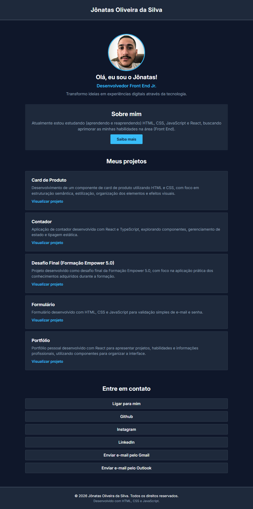

## 🔗 Linktree - Perfil Digital

- Um espaço único para apresentar minha trajetória, compartilhar meus projetos e conectar minhas redes profissionais.

- O Linktree — Digital Profile é um projeto desenvolvido com HTML, CSS e JavaScript, com o objetivo de criar uma página pessoal moderna, organizada e intuitiva para centralizar minhas principais informações, projetos e formas de contato.

- Além de funcionar como um cartão de visitas digital, este projeto representa uma oportunidade de colocar em prática conceitos fundamentais do desenvolvimento Front End.

## ✨ Sobre o Projeto

- A proposta é desenvolver uma página de perfil digital inspirada no conceito de Linktree, mas com identidade visual própria e estrutura personalizada.

- A aplicação reúne informações sobre mim, projetos desenvolvidos durante minha jornada de aprendizado e links para minhas principais plataformas profissionais e pessoais.

- O desenvolvimento está sendo realizado com tecnologias nativas da Web, priorizando organização do código, semântica, acessibilidade e boas práticas de desenvolvimento.

## 📸 Captura de Tela



## 🚀 Tecnologias Utilizadas

<p align="left">
    
    
    
    
</p>

- **CSS3**: Estilização, criação de layouts, efeitos visuais e organização dos componentes.
- **Google Fonts**: Utilização da família tipográfica Inter.
- **HTML5**: Estruturação do conteúdo com elementos semânticos e boas práticas de acessibilidade.
- **JavaScript**: Implementação de interatividade e manipulação do DOM.

## 🧠 Conceitos e Conhecimentos Aplicados

Durante o desenvolvimento, estou colocando em prática conhecimentos como:

- Acessibilidade e atributos ARIA;
- Estruturação de layouts;
- Flexbox e CSS Grid;
- HTML semântico;
- Manipulação do DOM com JavaScript;
- Organização de classes utilizando a metodologia BEM;
- Organização e separação de arquivos;
- Seletores e pseudo-classes CSS;
- Tipografia e hierarquia visual;
- Variáveis CSS para padronização visual.

## 🎯 Funcionalidades

- Apresentação pessoal e profissional.
- Centralização de redes sociais e contatos.
- Rodapé com informações do projeto.
- Seção de projetos com links externos.
- Seção Sobre mim.

## 📁 Estrutura do Projeto

```text
linktree/
│
├── assets/
│   └── images/
│       └── perfil-imagem.jpeg
│       └── screenshot.jpeg
|
├── css/
│   └── styles.css
│
├── js/
│   └── scripts.js
|
├── index.html
│
└── README.md
```

## 📚 Objetivo de Aprendizado

- Este projeto faz parte da minha jornada de desenvolvimento Front End e tem como objetivo consolidar conhecimentos em HTML, CSS e JavaScript por meio de uma aplicação prática.

- Mais do que desenvolver uma página visualmente agradável, busco compreender cada etapa da construção, aplicar boas práticas e evoluir continuamente como desenvolvedor.

## Entre em Contato

<p align="left">
    <a
        href="https://wwww.github.com/jonatasoliveiradasilva"
        target="_blank"
    >
        
    </a>
    <a
        href="https://www.linkedin.com/in/jonatasoliveiradasilva"
        target="_blank"
    >
        
    </a>
</p>

### ⭐ Se este projeto despertou seu interesse, fique à vontade para conhecer os meus outros repositórios!
